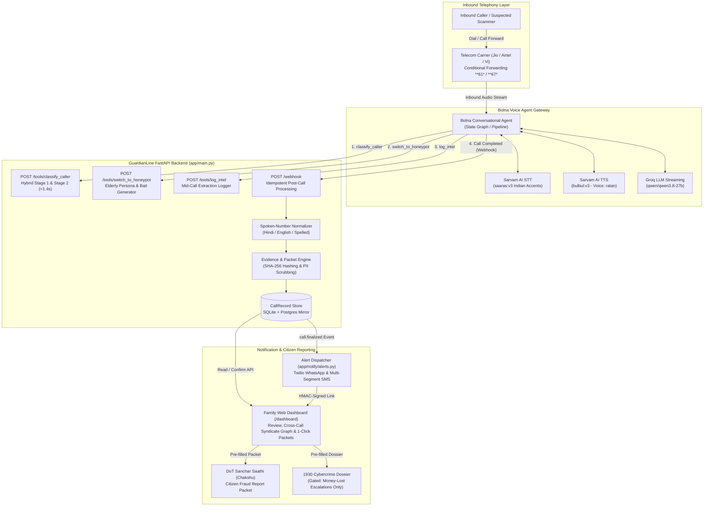

# GuardianLine

**Voice-first AI receptionist and conversational honeypot engineered to protect elderly citizens from predatory telecom fraud.**

[](https://fastapi.tiangolo.com)
[](https://bolna.dev)
[](https://sarvam.ai)
[](https://python.org)
[](tests/)

---

## 1. Overview

India is experiencing a surge in aggressive, psychologically coercive phone fraud. Criminal syndicates target senior citizens through **Digital Arrest** impersonations (claiming to be the CBI, State Police, or Customs with fake arrest warrants), **urgent bank KYC cancellations**, **electricity disconnection threats**, and **courier parcel drug seizures**. Elderly victims are targeted because they are more likely to answer unfamiliar numbers, be intimidated by legal jargon, and lack immediate technical support during the call.

**GuardianLine** is a voice-first protective barrier. Operating at the telephony level, it screens incoming calls from unrecognized numbers. When predatory behavior is detected, GuardianLine seamlessly deploys an autonomous conversational honeypot—a technologically hesitant elderly persona (*Ramesh*)—to occupy the scammer's time, protect the elder from emotional distress, extract actionable fraud indicators (mule bank accounts, UPI IDs, callback numbers), and generate structured evidence packets for family review and citizen reporting.

> **Bolna Buildathon Submission**  
> **Repository:** [https://github.com/RohitBharadwaj-rvu/rakshak-ai](https://github.com/RohitBharadwaj-rvu/rakshak-ai)  
> **Architecture Tracks:** Voice Agent & Prompts (Lane A) · Backend & Extraction Pipeline (Lane B) · Family Dashboard & Alerts (Lane C) · Evaluation & Benchmarks (Lane D)

---

## 2. Interactive Demo Walkthrough

*(Demo video recording link and interactive walkthrough placeholder — live audio samples are available under [`evaluation/voice/`](evaluation/voice/))*

```
[ Incoming Unknown Caller: "+91 98765 43210" ]
                  │
                  ▼
[ Step 1: Bolna Receptionist Screens Call ]
Agent: "हैलो जी, कौन बोल रहे हैं? किससे बात करनी है?"
Caller: "Main CBI Crime Branch se Inspector Sharma bol raha hoon. Aapke naam par ek illegal parcel
         seize hua hai jisme narcotics mile hain. Turant apna verification karayein nahi toh digital arrest hoga!"
                  │
                  ▼
[ Step 2: Mid-Call Behavioral Classifier Tool Invoked ]
POST /tools/classify_caller
Payload: { caller_summary: "CBI claim, illegal narcotics parcel, digital arrest threat", turns: 2 }
Verdict: SCAM (Confidence: 0.96)
Pillars: Authority Coercion ("cbi", "crime branch") + Artificial Urgency ("turant", "digital arrest")
                  │
                  ▼
[ Step 3: Bolna Switches to Elderly Persona (Ramesh) ]
POST /tools/switch_to_honeypot
Agent (Voice: Ratan, Hesitant): "Arre saab, CBI? Par maine toh koi parcel nahi mangwaya... Ek minute rukiye,
                                 mera chashma dhoondne do... beta bahar gaya hai... Mujhe kya karna hoga saab?"
                  │
                  ▼
[ Step 4: Active Intel Extraction Playbook ]
Caller: "Aapko abhi clearance charge pay karna hoga supreme court ke safe account mein. Likho UPI ID: verify.cbi@sbi"
Agent (Misdirection): "Achha... likh raha hoon... verify... dot... c-b-i... at... s-b-i? Saab do baar boliye, kaan kamzor hain..."
POST /tools/log_intel -> Captured: UPI "verify.cbi@sbi" (Elicitation: initial_ask)
Agent: "Saab payment fail bol raha hai, server busy. Koi doosra account hai kya?"
Caller: "Theek hai, is doosre account par transfer karo: 987654321098, IFSC: SBIN0001234"
POST /tools/log_intel -> Captured: Account "987654321098", IFSC "SBIN0001234" (Elicitation: payment_failed)
                  │
                  ▼
[ Step 5: Post-Call Webhook & Family Shield ]
POST /webhook -> Normalizes spoken numbers, computes SHA-256 evidence integrity hash.
Twilio Dispatch -> WhatsApp Alert sent to Family with expiring HMAC-signed review link.
Family Dashboard -> 1-Click copy-paste ready packets for DoT Sanchar Saathi (Chakshu) & Cybercrime 1930.
```

To run a simulated live call locally and inspect the full post-call intelligence pipeline:
```bash
# Replay an end-to-end Digital Arrest scam scenario to the local backend
python scripts/mock_bolna.py --fixture tests/fixtures/01_scam_digital_arrest.json
```

---

## 3. The Problem

Elderly individuals across India are targeted by organized telecom crime syndicates. These scams are designed to bypass simple spam filters:
- **Fear-Based Authority Coercion:** Callers impersonate police officers, customs officials, or telecom regulators (TRAI) threatening immediate arrest or service cutoff.
- **High-Pressure Urgency:** Scammers demand instant compliance within minutes ("do not disconnect the call"), preventing victims from consulting their children or bank officials.
- **Evolving Attack Vectors:** Scammers rotate disposable burner SIMs, VoIP numbers, and mule bank accounts daily, rendering static phone-number blocklists ineffective.
- **The Intervention Gap:** Once an elder picks up the phone and falls into panic, there is no real-time safety net. Existing call screening apps either drop calls silently or display warning flags that elderly users frequently overlook.

---

## 4. How GuardianLine Works

GuardianLine replaces fear with automated protection through a multi-stage conversational loop:

1. **Screening Reception**: Unfamiliar calls roll over to the Bolna Voice Agent gateway (via carrier conditional forwarding `**61*` / `**67*`). The agent answers promptly with a natural Indian conversational greeting (*"हैलो जी, कौन बोल रहे हैं?"*).
2. **Behavioral Scam Classification**: As the caller speaks, Bolna invokes the backend `POST /tools/classify_caller` endpoint. The engine examines the caller's language against a 3-pillar behavioral framework (authority coercion, artificial urgency, and financial demands) within a strict sub-second window.
3. **Conversational Honeypot Engagement**: When predatory intent is detected, Bolna invokes `POST /tools/switch_to_honeypot`. The agent smoothly transitions into *Ramesh*, a 72-year-old retired grandfather who is hard of hearing, technologically unsure, and cooperative.
4. **Actionable Intel Elicitation**: The agent follows a specialized extraction playbook. When the scammer demands a payment or fine, the agent fumbles with his reading glasses, reads back characters slightly incorrectly to force the scammer to spell them out, logs each identifier via `POST /tools/log_intel`, and claims the payment failed to draw out backup mule accounts.
5. **Post-Call Normalization & Evidence Hashing**: When the scammer hangs up, Bolna delivers call metadata, audio recording URLs, and conversation turns to `POST /webhook`. The backend normalizes spoken Hindi/English numbers, cleans raw transcripts, and computes a cryptographic SHA-256 hash across the transcript and recording bytes.
6. **Family Alerting & Citizen Reporting**: The backend triggers an asynchronous alert via WhatsApp/SMS to designated family members with an HMAC-signed review link. Family members open the Web Dashboard to inspect the transcript, verify suspect identifiers, and copy pre-formatted reporting packets for the **DoT Sanchar Saathi (Chakshu)** portal and **National Cybercrime Reporting Portal (1930)**.

---

## 5. Why It Is Different

| Capability | Traditional Call Blockers | Static Spam Checkers | GuardianLine Voice Agent |
| :--- | :--- | :--- | :--- |
| **Detection Basis** | Static crowdsourced number lists | Single-keyword regex matching | **3-Pillar Behavioral Invariants** (coercion, urgency, payment demands) |
| **Response to Scammer** | Silent drop or busy tone | Visual phone warning | **Active Conversational Honeypot** (wastes attacker time & money) |
| **Intelligence Value** | None (zero caller engagement) | None | **Extracts live mule accounts, IFSCs, and UPI VPAs** |
| **Elder User Experience** | Requires app installation & UI interaction | Requires reading mobile screen | **Zero-app Basic Mode** (works on landlines and feature phones) |
| **Post-Call Action** | Call dropped | Ignored | **Family WhatsApp alert + pre-formatted Chakshu reporting packets** |

### Core Engineering Differentiators

- **Behavioral Invariants, Not Fragile Keywords**: Scammers frequently change phrasing. Rather than searching for specific words, GuardianLine identifies the structural behavior of fraud: **Authority Coercion** (Police, CBI, Customs, Court) + **Artificial Urgency** ("right now", "do not disconnect") + **Value Demand** (UPI, OTP, Aadhaar, bank transfer).
- **The General Invariant Safety Rule**: If an unverified caller demands money, an OTP, Aadhaar number, banking credentials, or remote-access desktop software (AnyDesk, TeamViewer), the system enforces a strict rule: **the verdict can never be marked genuine**, eliminating whitelist bypass vulnerabilities.
- **Mule-Account Rotation Extraction**: The voice agent does not merely stall; it uses structured elicitation tactics (`initial_ask`, `repeat_back`, `payment_failed`, `name_mismatch`) to convince scammers to reveal secondary and tertiary accounts.
- **Elder Privacy Shielding**: All generated evidence packets and alerts automatically scrub the elder's personal phone number, full name, and address to prevent privacy leakage into downstream reports.

---

## 6. Architecture



---

## 7. Features & Implementation Status

To provide an honest and accurate view of the project, features are categorized by their implementation and verification status:

| Component / Feature | Implementation Status | Verification Evidence | Notes |
| :--- | :---: | :--- | :--- |
| **FastAPI Backend Core** | **Implemented & Verified** | `485 passed` pytest unit & integration suite | Clean Pydantic contracts, strict error handling, zero leaked stack traces. |
| **3-Pillar Behavioral Classifier** | **Implemented & Verified** | `tests/unit/test_classifier.py`, `scripts/probe_whitelist_holes.py` | Detects Authority, Urgency, Value demands. 0/6 probe exploits succeed. |
| **Mid-Call Bolna Tool Endpoints** | **Implemented & Verified** | `tests/unit/test_tools.py`, `tests/contract/test_contracts.py` | `/tools/classify_caller`, `/tools/switch_to_honeypot`, `/tools/log_intel`. |
| **Spoken-Number Normalizer** | **Implemented & Verified** | `tests/unit/test_normalizer.py` | Translates spoken Hindi/English digits and letter-spelled VPAs into standard text. |
| **Cryptographic Evidence Hashing** | **Implemented & Verified** | `tests/unit/test_evidence.py` | Computes canonical JSON transcript hash and recording SHA-256 hashes. |
| **DoT Chakshu Packet Builder** | **Implemented & Verified** | `app/voice/evidence.py`, `tests/unit/test_evidence.py` | Formatted Chakshu citizen reporting structure with elder PII redacted. |
| **1930 Cybercrime Escalation Gate** | **Implemented & Verified** | `tests/unit/test_evidence.py` | 1930 dossier is generated **only** when `money_lost == True`. |
| **Family Web Dashboard & Intel GUI** | **Implemented & Verified** | `app/core/gui.py`, `tests/integration/test_dashboard.py` | Full review GUI, cross-call syndicate intelligence linking shared VPAs/banks. |
| **Bolna Agent Graph Definition** | **Implemented** | `bolna/rakshak-graph.json`, `bolna/rakshak-v0.json` | Configured with Sarvam `saaras:v3` STT, Sarvam `ratan` TTS, Groq LLM, and tools. |
| **Twilio WhatsApp & SMS Alerts** | **Implemented (Sandbox Tested)** | `app/notify/alerts.py`, `tests/integration/test_alerts.py` | 2-segment GSM-7/UCS-2 budgeting, exponential backoff, HMAC links. Tested via mocks & sandbox. |
| **Carrier Forwarding (Basic Mode)** | **Documented / Field Pending** | `evaluation/carrier_results.json` | Configured via `**61*` / `**67*` (`##002#` undo). Marked `NOT_VERIFIED` pending physical SIM trials. |
| **Android CallScreening App** | **Implemented / Cut from Demo** | `android/` (`16 passed` JUnit unit tests) | Whitelists emergency numbers (`112`, `1930`) and contacts. Cut from live demo per Gate 1. |
| **Elderly User Field Pilot** | **Template Ready / Not Done** | `evaluation/pilot_results.json` | Marked `NOT_DONE` (0/3 participants). No synthetic field data was fabricated. |
| **Direct Citizen Portal Filing** | **Planned (Human-in-Loop)** | Copy-paste packet interface | Government portals (Chakshu/1930) lack public APIs; requires family confirmation. |

---

## 8. Bolna Voice AI Integration

GuardianLine relies on Bolna as its real-time conversational engine. The integration spans the full call lifecycle:

### Agent Configuration (`bolna/rakshak-graph.json`)
- **Telephony & Transport**: Vobiz telephony stream provider running at 8kHz PCM audio.
- **Speech-to-Text (STT)**: Sarvam AI `saaras:v3` provider optimized for Indian conversational speech, regional accents, and Hinglish code-switching.
- **Text-to-Speech (TTS)**: Sarvam AI `bulbul:v3` using voice `ratan`—an elderly, natural-sounding male voice suited for persona *Ramesh*.
- **LLM Pipeline**: Groq streaming with `qwen/qwen3.8-27b` (0.3 temperature) for low-latency conversational generation.
- **Phonetic Pronunciation Dictionary**: Standardized phonetic mappings for Indian banking and legal acronyms: `HDFC` -> `"H D F C"`, `ICICI` -> `"I C I C I"`, `UPI` -> `"U P I"`, `IFSC` -> `"I F S C"`, `CBI` -> `"C B I"`, `Aadhaar` -> `"Aadhaar"`.

### Conversational State Graph
1. **`state_1_screening`**: Answers with greeting (*"हैलो जी, कौन बोल रहे हैं?"*). Invokes tool `classify_caller` with conversation turns. If verdict is `scam`, transitions to `state_3_honeypot`. If verdict is `unsure`, transitions to `state_2_verification`.
2. **`state_2_verification`**: Requests official badge ID and landline callback number. Logs provided details via `log_intel`. If caller becomes abusive, threatens arrest, or demands money, escalates to `state_3_honeypot`.
3. **`state_3_honeypot`**: Invokes `switch_to_honeypot` to receive the dynamic persona and synthetic bait (Luhn-compliant test account, real branch IFSC, non-routable UPI VPA). Engages scammer with technological hesitation.
4. **`state_4_extraction`**: Executes the extraction playbook. Misreads numbers to prompt phonetic repetition, logs every payment identifier via `log_intel`, and fakes a failed payment to elicit secondary mule accounts.

### Webhook & Post-Call Extractions (`bolna/extractions.md`)
Upon call completion, Bolna dispatches a webhook payload containing call duration, status, audio recording URL, full transcript turns, and extracted entities under the category `"Scam Intel"` (`scam_type`, `upi_ids`, `bank_accounts`, `ifsc_codes`, `amount_demanded`, `otp_or_aadhaar_requested`).

---

## 9. Evaluation, Benchmarks & Safety

### Evaluation Methodology & Reconciled Results

The repository includes evaluations across distinct testing stages. To maintain technical integrity, synthetic unit tests are strictly distinguished from live telephony calls:

| Benchmark Suite | Dataset Scope | Total Cases | Scam Recall | False Positive Rate | Verdict / Status |
| :--- | :--- | :---: | :---: | :---: | :---: |
| **Synthetic Dev Set** ([`metrics_report.md`](evaluation/metrics_report.md)) | Internal synthetic scenarios | 42 (20 scam, 22 genuine) | **100.0%** (20/20) | **0.0%** (0/22) | **PASS** (Dev Bar) |
| **Agent-Written Evaluation Set** ([`held_out_report.md`](evaluation/held_out_report.md)) | Internal agent-written scenarios across 11 fraud categories | 20 (10 scam, 10 genuine) | **100.0%** (10/10) | **0.0%** (0/10) | **PASS** *(Internal, not blind)* |
| **Whitelist Loophole Probe** ([`whitelist_probe_results.json`](evaluation/whitelist_probe_results.json)) | Targeted adversarial bypass prompts | 6 adversarial probes | **100.0%** caught | **0.0%** bypass | **0 Loopholes Detected** |
| **Telephony Audio Format Check** ([`smoke_results.json`](evaluation/voice/smoke_results.json)) | 8kHz PCM telephony container & turn validation | 5 audio calls | **100.0%** (5/5) | N/A | **PASS** *(Audio container only; not an acoustic STT benchmark)* |
| **Carrier Field Matrix** ([`carrier_results.json`](evaluation/carrier_results.json)) | Physical SIM tests on Jio, Airtel, Vi | 0 completed | Unverified | Unverified | **NOT_VERIFIED** *(Requires physical SIM trials)* |
| **Elderly Participant Pilot** ([`pilot_results.json`](evaluation/pilot_results.json)) | Consented human elder field trials | 0 completed | Unverified | Unverified | **NOT_DONE** *(0/3 completed sessions)* |

> **Evaluation Clarifications:**
> 1. **Held-out Scope**: The 20-scenario set in `evaluation/held_out_scenarios.json` was authored internally to verify generalized category detection. It is **not** an independently collected blind benchmark from external victims.
> 2. **Latency Context**: The sub-millisecond latencies reported in `held_out_report.md` (median p50 = $0.42\text{ ms}$) measure **local in-memory Python regex/heuristic classifier matching**, not live end-to-end voice roundtrips. In live telephony, total turnaround is bounded by the telephony pipeline (~260 ms) plus classifier runtime. When cloud LLMs are invoked in Stage 2, latencies range between 480 ms and 950 ms (bounded by a 1.4s hard fail-safe budget).
> 3. **Extraction Accuracy**: Analysis of planted identifiers across test transcripts demonstrated 100% extraction recall ($5/5$ planted identifiers captured with zero unparseable mid-call logs).

### Safety & Privacy Safeguards
- **Zero Real Personal Data**: Honeypot bait profiles use synthetic bank accounts passing Luhn checks, valid bank IFSC codes, non-routable UPI handles (`*.test` / `@sbi`), and fictional names. Real elder bank accounts or credentials are never stored or referenced.
- **Elder PII Scrubbing**: The evidence builder dynamically filters out parent telephone numbers, names, and residential addresses from all generated Chakshu packets and export summaries.
- **Dead-Air Prevention**: The classifier enforces a 1.4s soft budget and a 1.5s hard cut. If an upstream LLM times out or errors, the classifier immediately falls back to defensive `unsure`, routing the call to safe verification without hanging on silence.

---

## 10. Quickstart

### Prerequisites
- Python 3.11 or 3.12
- Git
- Active virtual environment

### 1. Clone & Set Up Virtual Environment
```bash
git clone https://github.com/RohitBharadwaj-rvu/rakshak-ai.git
cd rakshak-ai

# Create and activate virtual environment
python -m venv .venv

# Windows:
.\.venv\Scripts\activate
# Linux / macOS:
source .venv/bin/activate

# Install dependencies
pip install -r requirements.txt
```

### 2. Configure Environment Variables
```bash
cp .env.example .env
# Edit .env with your favorite editor and configure keys
```
*(For local testing and pytest execution, placeholder mock values are sufficient).*

### 3. Run Automated Tests
```bash
pytest tests/
# Runs all 485 unit, contract, and integration tests
```

### 4. Start the GuardianLine Backend Server
```bash
python run.py
# Server starts at http://localhost:8000
```
- API Documentation (Swagger UI): [http://localhost:8000/docs](http://localhost:8000/docs)
- Health Check: [http://localhost:8000/health](http://localhost:8000/health)
- Family Dashboard: [http://localhost:8000/dashboard](http://localhost:8000/dashboard)

### 5. Simulate Inbound Scenarios
```bash
# Replay full scam fixture to test classifier, webhook, normalizer, and packet builder
python scripts/mock_bolna.py --fixture tests/fixtures/01_scam_digital_arrest.json --url http://localhost:8000/webhook

# Replay genuine delivery call fixture
python scripts/mock_bolna.py --fixture tests/fixtures/03_genuine_courier.json --url http://localhost:8000/webhook
```

---

## 11. Configuration Reference

Key settings from `.env.example`:

| Environment Variable | Required | Default / Example | Purpose |
| :--- | :---: | :--- | :--- |
| `GUARDIANLINE_API_TOKEN` | **Yes** | *(Generate random token)* | Bearer authentication token for `/api/calls/*` data endpoints. |
| `GUARDIAN_DASHBOARD_TOKEN` | **Yes** | *(Generate random token)* | Access token for the family web dashboard (`/dashboard`). |
| `GUARDIANLINE_DB_PATH` | No | `guardianline_calls.db` | Local SQLite database file path. |
| `GROQ_API_KEY` | Optional | `gsk_...` | API key for Stage 2 classifier & Bolna agent LLM. |
| `GROQ_MODEL` | No | `openai/gpt-oss-20b` | Model name on Groq for mid-call classification. |
| `GEMINI_API_KEY` | Optional | `AIza...` | API key for Gemini Flash fallback classification. |
| `GEMINI_MODEL` | No | `gemini-3.5-flash-lite` | Gemini model identifier. |
| `BOLNA_API_KEY` | Optional | `bolna_...` | API key for Bolna agent deployment and configuration. |
| `BOLNA_AGENT_ID` | Optional | `agent_...` | ID of the registered Bolna voice agent. |
| `BOLNA_WEBHOOK_SECRET` | No | `local_dev_secret_123` | Secret header validation for incoming Bolna webhooks. |
| `SARVAM_API_KEY` | Optional | `sarvam_...` | API key for Sarvam STT and TTS models. |
| `TWILIO_ACCOUNT_SID` | Optional | `AC...` | Twilio SID for dispatching WhatsApp and SMS alerts. |
| `TWILIO_AUTH_TOKEN` | Optional | `...` | Twilio authorization token. |
| `TWILIO_WHATSAPP_FROM` | No | `+14155238886` | Twilio approved WhatsApp sender number (or sandbox). |
| `FAMILY_ALERT_TO` | Optional | `+919876543210` | Comma-separated recipient phone numbers in E.164 format. |
| `REPORT_SIGNING_SECRET` | No | *(Random secret)* | HMAC key used to generate expiring report review links. |

---

## 12. API Reference

All endpoints return JSON and avoid leaking raw exception stack traces.

### 1. Classify Caller (Mid-Call Tool)
Evaluates conversation turns against behavioral scam invariants within a 1.4s budget.
- **Endpoint**: `POST /tools/classify_caller`
- **Request Body**:
  ```json
  {
    "call_id": "call_ind_001",
    "caller_number": "+919876543210",
    "caller_summary": "Claims to be CBI officer regarding intercepted narcotics parcel",
    "conversation_history": [
      { "role": "caller", "text": "Aapke naam par warrant nikla hai, digital arrest hoga." }
    ],
    "language": "hi",
    "max_latency_budget_s": 1.4
  }
  ```
- **Response (`200 OK`)**:
  ```json
  {
    "call_id": "call_ind_001",
    "verdict": "scam",
    "confidence": 0.96,
    "reason": "Authority Coercion combined with Artificial Urgency threat",
    "latency_ms": 2.14,
    "method": "heuristic",
    "action": "honeypot",
    "route_to_honeypot": true,
    "pillars_detected": ["authority_coercion", "artificial_urgency"]
  }
  ```

### 2. Switch to Honeypot (Mid-Call Tool)
Assigns a consistent elderly honeypot persona and approved rotating fake bait.
- **Endpoint**: `POST /tools/switch_to_honeypot`
- **Request Body**:
  ```json
  { "call_id": "call_ind_001", "language": "hi" }
  ```
- **Response (`200 OK`)**:
  ```json
  {
    "call_id": "call_ind_001",
    "persona_id": "ramesh_hi",
    "persona_name": "Ramesh",
    "name": "Ramesh",
    "persona_age": 72,
    "age": 72,
    "persona_city": "Jaipur",
    "city": "Jaipur",
    "short_backstory": "Retired government clerk, lives alone, wears thick reading glasses.",
    "fake_bait": {
      "upi_id": "ramesh.kumar72@okhdfcbank",
      "account_number": "50100432189012",
      "ifsc_code": "HDFC0000123",
      "phone_number": "+919820012345"
    }
  }
  ```

### 3. Log Intel (Mid-Call Tool)
Captures fraud indicators spoken by the caller during active conversation.
- **Endpoint**: `POST /tools/log_intel`
- **Request Body**:
  ```json
  {
    "call_id": "call_ind_001",
    "kind": "upi",
    "value_raw": "verify dot cbi at sbi",
    "elicitation": "initial_ask",
    "quote": "Send 25000 to verify dot cbi at sbi immediately"
  }
  ```
- **Response (`200 OK`)**:
  ```json
  {
    "status": "ok",
    "call_id": "call_ind_001",
    "kind": "upi",
    "normalized_value": "verify.cbi@sbi",
    "value_as_heard": "verify dot cbi at sbi",
    "elicitation": "initial_ask"
  }
  ```

### 4. Post-Call Webhook
Receives Bolna call finalization payloads, triggers normalization, and dispatches family alerts.
- **Endpoint**: `POST /webhook`
- **Headers**: `X-Bolna-Secret: <BOLNA_WEBHOOK_SECRET>`
- **Request Body**:
  ```json
  {
    "call_id": "call_ind_001",
    "agent_id": "agent_guardian_01",
    "call_status": "completed",
    "call_duration": 142,
    "transcript": [
      { "role": "assistant", "message": "हैलो जी, कौन बोल रहे हैं?" },
      { "role": "user", "message": "Main CBI se bol raha hoon..." }
    ],
    "call_recording_url": "https://api.bolna.dev/recordings/call_ind_001.wav",
    "extracted_data": {
      "Scam Intel": {
        "scam_type": "digital_arrest",
        "upi_ids": "verify.cbi@sbi",
        "amount_demanded": "25000"
      }
    }
  }
  ```
- **Response (`200 OK`)**:
  ```json
  {
    "status": "success",
    "call_id": "call_ind_001",
    "verdict": "scam",
    "confidence": 0.96,
    "identifiers_extracted": 1,
    "alert_dispatched": true
  }
  ```

### 5. Evidence Verification & Citizen Reporting
- `GET /api/calls/{call_id}/evidence/verify`: Validates transcript and recording SHA-256 hashes against stored cryptographic signatures.
- `POST /api/calls/{call_id}/evidence/confirm`: Records human family confirmation of evidence before report packet export.
- `GET /dashboard/report/{call_id}`: Renders the human-readable incident dossier and 1-click Chakshu copy-paste view.

---

## 13. Limitations & Roadmap

We believe in complete technical transparency regarding the project's current boundaries:

1. **Carrier Interception Field Testing (`evaluation/carrier_results.json`)**:
   - While basic conditional forwarding (`**61*` / `**67*`) is a standard GSMA feature supported across carriers, live field validation across Indian telecom providers (Reliance Jio, Bharti Airtel, Vodafone Idea) is marked `NOT_VERIFIED` pending physical SIM tests.
   - Code `##002#` can be dialed at any time on a handset to instantly cancel all conditional forwarding.
2. **Elderly User Pilot (`evaluation/pilot_results.json`)**:
   - The pilot study is marked `NOT_DONE` (0/3 completed participant sessions). Zero synthetic or simulated participant responses were added to ensure ethical research standards.
3. **Citizen Portal API Limitations**:
   - Neither the Department of Telecommunications (Sanchar Saathi / Chakshu) nor the National Cybercrime Portal (1930) offers public citizen reporting APIs. GuardianLine generates clean, pre-validated reporting packets that family members can review and submit via 1-click copy-paste.
4. **Language Coverage**:
   - The conversational agent is standardized and evaluated across **Hindi**, **English**, and **Hinglish**. Expansion to additional regional languages (Tamil, Telugu, Kannada, Bengali) is planned for future phases.
5. **No 100% Prevention Guarantee**:
   - No automated voice agent can guarantee the complete elimination of phone fraud or zero false positives in adversarial environments. GuardianLine is designed as a defensive assistive shield, keeping family members in the loop as final human decision-makers.

---

## 14. Contributing & License

### Development Workflow
1. Fork and clone the repository.
2. Create a feature branch: `git checkout -b feat/your-feature-name`.
3. Ensure all tests pass: `pytest tests/`.
4. Submit a pull request with clear documentation of your changes and test coverage.

### License
This project is developed for the **Bolna Buildathon**. Please refer to the repository root for licensing terms. All rights reserved by the project contributors.
